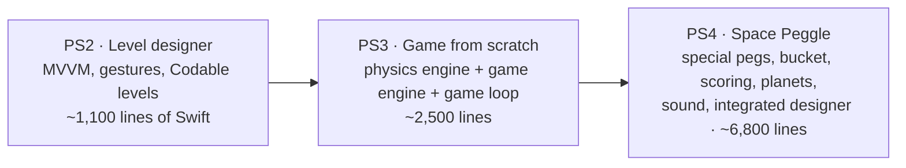
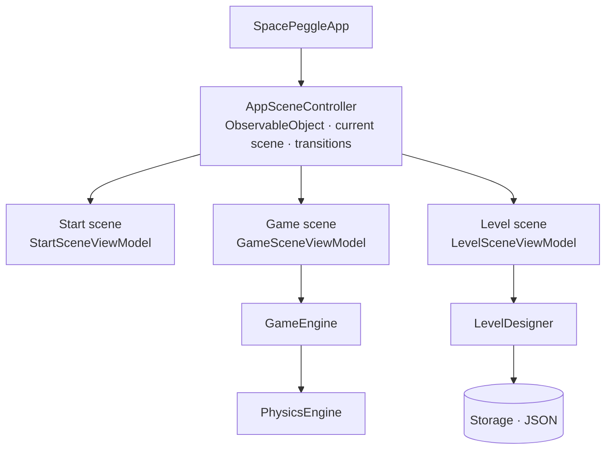
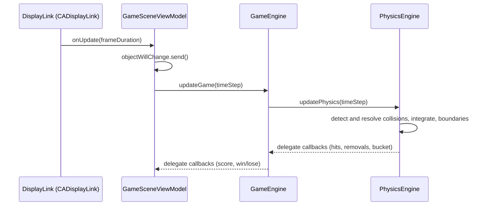

# Space Peggle: architecture

> [!NOTE]
> This architecture write-up was added by
> [Claude Opus 5.5](https://docs.anthropic.com/en/docs/claude-code) in Nov 2026 using my
> [agentic-repo-analysis](https://github.com/sp4ce-cowboy/agentic-workflows) skill, from the
> project's code, git history and documentation.

A technical write-up of Space Peggle, from the code, the git history of all three problem
sets (PS2 to PS4), and the developer guides written for each. Back to the [README](README.md).

**Contents:**
1. [From PS2 to PS4](#1-from-ps2-to-ps4)
2. [Stack](#2-stack)
3. [App structure](#3-app-structure)
4. [Two layers: game and physics](#4-two-layers-game-and-physics)
5. [The game loop](#5-the-game-loop)
6. [The physics engine](#6-the-physics-engine)
7. [Collision detection by double dispatch](#7-collision-detection-by-double-dispatch)
8. [Gameplay on top of the engine](#8-gameplay-on-top-of-the-engine)
9. [The level designer and persistence](#9-the-level-designer-and-persistence)
10. [Open–closed rendering](#10-openclosed-rendering)
11. [Testing](#11-testing)
12. [Decisions and trade-offs](#12-decisions-and-trade-offs)
13. [Effort and timeline](#13-effort-and-timeline)
14. [Known issues and hindsight](#14-known-issues-and-hindsight)

## 1. From PS2 to PS4

The game was built in three problem sets, each on top of the last:



Each problem set came with a developer guide: PS2 about 6,900 words, PS3 about 4,700, and
PS4 about 3,200 ([README-ORIGINAL.md](README-ORIGINAL.md)). PS4 also had to reflect on PS2 and
PS3. The main technical debt paid down in PS4 was separating the layers where the physics
and game engines had crossed.

## 2. Stack

| | |
|---|---|
| Language | Swift 5 |
| UI | SwiftUI only (no UIKit views, no SpriteKit), with `GeometryReader` for one coordinate space |
| Frame timing | `CADisplayLink`, wrapped in a `DisplayLink` class |
| Audio | AVFoundation (`AVAudioPlayer`) |
| Persistence | `Codable` and `JSONEncoder` to the app's documents directory |
| Tests | XCTest |
| Style | SwiftLint (the build runs `swiftlint --fix` and `swiftlint`) |
| Target | iPad, iPadOS 17.2+ |

## 3. App structure



- **Three scenes**, each a root view with its own view model: start (menus, level select,
  settings), game, and level design.
- **`AppSceneController`** works like a VIPER presenter. It owns the current scene and the
  level being passed between scenes, and the view models ask it for transitions.
- **Sub-views get their scene's view model as an `@EnvironmentObject`**, so no view needs
  one passed through its initialiser.
- **The game view model is split by role**, using protocol extensions:
  - `DisplayLinkManager` (`+DLM`): the frame loop;
  - `GameObjectManager` (`+GOM`): what to draw;
  - `LaunchManager` (`+LC`): the cannon;
  - `+GM`: game-mechanic queries.

## 4. Two layers: game and physics

The central design decision, taken in PS3, was to keep a **game layer** and a **physics
layer** fully separate:

- A `GameObject` knows game things: its type, hit points, activation, how it is drawn.
- A `PhysicsObject` knows physics things: shape, mass, velocity, acceleration and whether it
  can move.
- Pegs conform to both. Both protocols build on `UniversalObject` (a centre point and a
  UUID), which lets objects be translated between the layers in real time.
- **`AbstractGameEngine` doesn't require any particular physics engine**, and the view model
  sees only an `AbstractGameEngine`. Any game engine can drive any physics engine, and they
  talk through `PhysicsEngineDelegate` and `GameEngineDelegate` (Interface Segregation).
- Levels are abstract too (`AbstractLevel`), so the engine is decoupled from how levels are
  stored.

**Why:** each engine can be developed, tested and reused alone. The physics engine has no
game rules in it. **The cost** is a translation layer between game objects and physics
objects, with some overhead and more interface to keep in sync. Both are weighed in the PS3
guide.

## 5. The game loop



The display link lives in the **view model, not the game engine**. That was a deliberate
MVVM choice, argued in the PS3 guide. Frame timing is a UI concern, and keeping it out of the
engine makes the engine testable without simulating display refreshes. The cost is indirect
control over update timing.

## 6. The physics engine

Each frame ([`updatePhysics`](https://github.com/sp4ce-cowboy/SpacePeggle/blob/2167e43069ef354a38f5b61d4369939aa6c73c4b/SpacePeggle/SpacePeggle/Models/PhysicsModels/PhysicsEngine/PhysicsEngine.swift#L64-L72)):

1. **Detect and resolve collisions** between every pair of bodies.
2. **Integrate (Euler):** gravity is a force `F = m·g`, and `F / m · Δt` updates the velocity.
   Velocity × Δt then updates the position.
3. **Boundaries:** walls reflect. Below the floor the ball exits, unless the spooky portal
   is active.

**Collision response**
([`calculateNewVelocities`](https://github.com/sp4ce-cowboy/SpacePeggle/blob/2167e43069ef354a38f5b61d4369939aa6c73c4b/SpacePeggle/SpacePeggle/Models/PhysicsModels/PhysicsEngine/PhysicsEngine%2BCollision.swift#L139-L197)):

- **One body fixed** (infinite mass, e.g. a peg or a block): reflect the moving body's
  velocity about the contact normal, `v' = v − 2(v·n)n`.
- **Both movable** (the ball and a stubborn peg): exchange momentum along the normal, using
  the two masses, so the total momentum is conserved.
- **Then correct the positions** using the penetration depth, so the bodies don't sink into
  each other. Finally, apply restitution, which is randomised within a range so the bounces
  feel natural.

**Explosions** ([`applySpecialPhysicsOn`](https://github.com/sp4ce-cowboy/SpacePeggle/blob/2167e43069ef354a38f5b61d4369939aa6c73c4b/SpacePeggle/SpacePeggle/Models/PhysicsModels/PhysicsEngine/PhysicsEngine%2BCollision.swift#L71-L98)):
a kaboom peg pushes every movable body within 4 radii. The push points away from the centre,
and its strength falls off linearly with distance:

```swift
let forceMagnitudeFactor = (1 - (distance / (radius * 4)))
let explosionForceMagnitude = baseExplosionStrength * forceMagnitudeFactor * radius
let explosionForce = normalizedDirection * explosionForceMagnitude
physicsObjects[objectId]?.velocity = physicsObject.velocity + explosionForce
```

Only bodies with finite mass are pushed. Fixed pegs stay put.

## 7. Collision detection by double dispatch

Shapes are `CircularShape` or `RectangularShape`, behind a `UniversalShape` protocol
([source](https://github.com/sp4ce-cowboy/SpacePeggle/blob/2167e43069ef354a38f5b61d4369939aa6c73c4b/SpacePeggle/SpacePeggle/Models/Shapes/UniversalShape.swift)).
Checking "does shape A hit shape B?" needs both concrete types, so it uses **double
dispatch** (the visitor pattern):

```swift
// RectangularShape
func intersects(with shape: UniversalShape, at thisPosition: Vector, and otherPosition: Vector) -> Double? {
    shape.intersects(withRectangle: self, at: thisPosition, and: otherPosition)
}
```

The first call dispatches on `self`, and the callback dispatches on the other shape. So
circle–circle, circle–rectangle and rectangle–rectangle each have one concrete method, and
there is no `switch` over types. Objective-C's dynamic dispatch was considered and dropped.

**An overlap is a `Double?`, not a `Bool`.** `nil` means no contact; a value is the
penetration depth. The depth is already computed in the maths (squares and roots), and the
position correction reuses it. Its precision also helps SwiftUI's gestures in the designer.

## 8. Gameplay on top of the engine

| Feature | How it works |
|---|---|
| **Goal pegs** | Clearing all orange pegs wins; 5 balls to start |
| **Hit points** | 1–10 per peg, set in the designer. A peg activates after that many hits from anything. This is gravity-independent, so it stays fair across planets |
| **Kaboom peg** | Explosion with linear falloff to 4 radii (section 6). Objects in the blast are activated |
| **Spooky peg** | "Domain Expansion": the floor becomes a portal, so the ball reappears at the top with the same velocity, until it enters the bucket |
| **Stubborn peg** | Finite mass, so it moves, collides and activates other pegs |
| **Block** | Immovable, infinite mass |
| **Bucket** | Must bounce the ball off its rim and also catch it, which one rectangle can't do. It is **three physics bodies** (`BucketLeft`, `BucketRight` and the catch zone, in `Bucket`), moving together and drawn as one image computed from the three |
| **Scoring** | 500 normal, 2,000 goal, 1,000 special, 10,000 bucket (plus a ball), and a 10,000 combo bonus for 10,000+ in one shot |
| **Planets** | 4 themes with different gravity; gravity can also be switched live (3 settings) |
| **Launcher** | Drag to aim (deliberately not tap-to-aim), tap to fire; the projected path accounts for launch speed and gravity |
| **Removal** | Lit pegs are removed when the ball exits. A timer watches the ball's speed, and if it stays below a threshold for long enough, the ball counts as stuck and the pegs holding it are cleared |

## 9. The level designer and persistence

- **Placement** is limited to a border that fits every iPad, using height and width ratios.
- **Editing:** tap to show the resizer (rotate and scale by dragging the edge) and the hit
  point controls. Long-press deletes.
- **Validation:** Save and Start are enabled only with a level name and at least one goal
  peg, so a game can't end the moment it starts.
- **Storage** ([`Storage`](https://github.com/sp4ce-cowboy/SpacePeggle/blob/2167e43069ef354a38f5b61d4369939aa6c73c4b/SpacePeggle/SpacePeggle/Models/Storage/Storage.swift)):
  levels and game objects are `Codable`, written as JSON to the documents directory, and
  listed, loaded and deleted by name. The load screen supports swipe-to-delete and delete-all.
- **Three preset levels** ship with the game, and a saved level remembers its power-up.

## 10. Open–closed rendering

Instead of a `switch` over object types, an `ObjectSet` maps each `gameObjectType` string to
an image and a size. A new peg type, or a whole new theme, is a new entry, not a change to
the game logic. A normal peg could look like a goal peg, a cannon or anything else without
the game noticing. Game objects never refer to their visuals directly.

## 11. Testing

- **Unit tests (XCTest):** `VectorTests` (vector maths, 116 lines), `PhysicsEngineTests`, and
  `LauncherTests`.
- **Test plans in the developer guides:** unit and integration plans, start-up visual
  checks, and gameplay scenarios for each problem set. The PS4 guide points back to the PS2
  and PS3 plans.

## 12. Decisions and trade-offs

| Decision | Alternatives | Why | Cost |
|---|---|---|---|
| Separate game and physics layers | The game engine owns physics objects (the usual design) | Modularity, testability, reuse of either engine | A translation layer, with some overhead |
| Display link in the view model | In the game engine | MVVM: timing is a UI concern, and the engine stays testable | Indirect control over update timing |
| Double dispatch for shape intersections | `switch` on types; Objective-C dynamic dispatch | No type switches; each pair has its own method | More methods per new shape |
| `Double?` overlap | `Bool` | Depth reused for correction; precise for gestures | — |
| Three-body bucket | One rectangle | Bounce and catch in one object | Keeping three bodies in sync at the walls |
| `ObjectSet` dictionary for visuals | Enums and switches | Open–closed; themes for free | Stringly-typed keys |
| SwiftUI only | UIKit | Modern, declarative, Apple's direction | SwiftUI's keyboard and gesture quirks (see below) |

## 13. Effort and timeline

| Problem set | Commits (his) | WakaTime | Dates |
|---|---|---|---|
| PS2 · Level designer | 19 | 54.6 h | 23 Jan – 5 Feb 2024 |
| PS3 · Physics and game engine | 32 | 103.4 h | 8 – 23 Feb 2024 |
| PS4 · Space Peggle | 91 | 112.2 h | 26 Feb – 6 Mar 2024 (docs to April) |
| **Total** | **142** | **270.2 h** | |

Peaks and the week-by-week chart are in the README's [Coding stats](README.md#coding-stats).

## 14. Known issues and hindsight

- Older iPads and simulators can lag on goal-peg hits, because of the sound-effect overhead.
  The `SOUND_EFFECTS_ENABLED` constant turns the effects off.
- SwiftUI's keyboard doesn't lift the level-name field when `.ignoresSafeArea` is applied.
  Autocorrect is left on so the typed text stays visible.
- **In hindsight** (PS4 reflection): MVVM only really clicked during PS3, and PS4 spent time
  separating layers that had crossed. Starting again, UIKit would be the pick over SwiftUI for
  a game like this.
