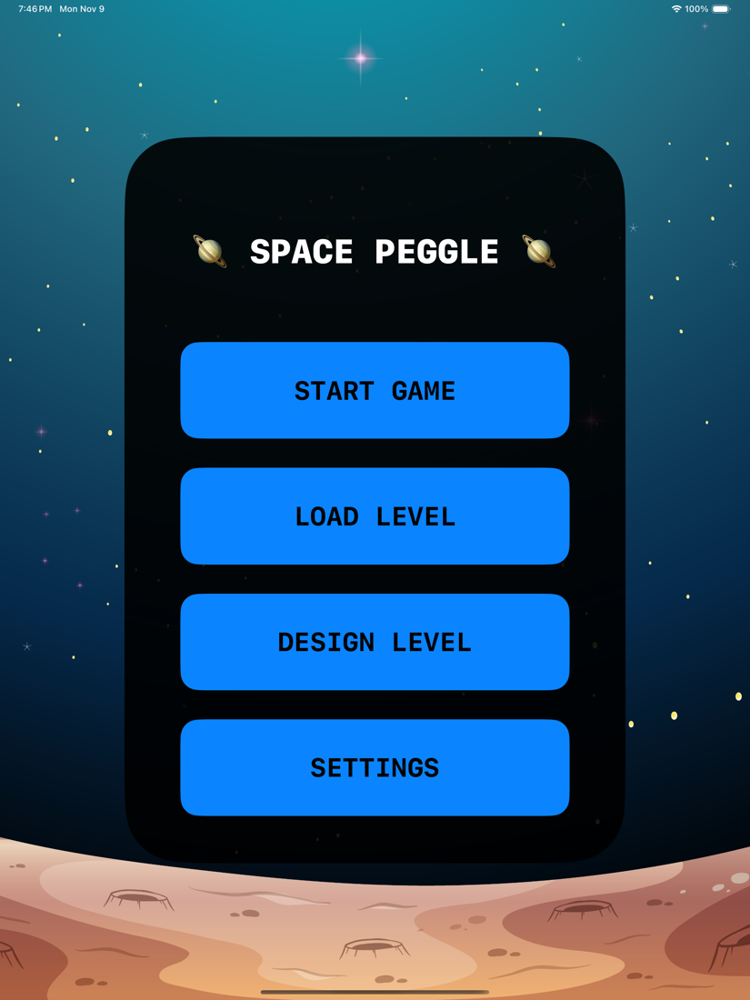
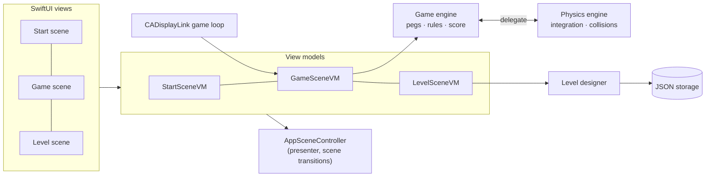

# Space Peggle

**A Peggle-style physics game for iPad, built from scratch in Swift and SwiftUI.** 
A hand-written physics engine, game engine and level designer, with no SpriteKit and no game
framework. Built for NUS CS3217 over three problem sets that build on each other.

> [!NOTE]
> This consolidated README page was added by [Claude](https://docs.anthropic.com/en/docs/claude-code)
> using my [agentic-repo-analysis](https://github.com/sp4ce-cowboy/agentic-workflows) skill, from the
> project's code, git history and documentation. The original README, my Problem Set 4 report and
> developer guide, is in **[DOCUMENTATION.md](DOCUMENTATION.md)**. The technical write-up is in
> **[ARCHITECTURE.md](ARCHITECTURE.md)**.

  

## At a glance

| | |
|---|---|
| **What** | A complete iPad game: launch a ball from a cannon, clear the orange pegs, catch the ball in a moving bucket. It has special pegs, levels you design yourself, four planets with their own gravity, music and sound |
| **Built with** | Swift and SwiftUI only (plus AVFoundation for audio). The physics engine, collision system, game loop and level persistence are all written from scratch |
| **Context** | NUS CS3217 *Software Engineering on Modern Application Platforms*, Problem Sets 2–4, Jan – Mar 2024 |
| **My role** | Sole developer: design, code, tests and developer documentation |
| **Effort** | 270 h of tracked coding across the three problem sets; 93 h in the peak week |
| **Status** | Complete; App Store publishing pending |

## The course

[CS3217](https://cs3217.github.io/cs3217-docs/) is NUS's course on software engineering for
modern application platforms, taught on iOS in Swift. It is known as one of the most demanding
software-engineering courses in the School of Computing. [Prof. Ben Leong](https://www.comp.nus.edu.sg/~bleong/)
ran its early editions (from 2011, when it was taught in Objective-C). In the course's own words
from that time: [*"CS3217 is really not for everyone. It's really quite hardcore and meant for the
most highly motivated to push themselves."*](https://comp.nus.edu.sg/~bleong/teaching/cs3217s11-midterm.htm)

The first half of the course is individual. Every student builds the same game, alone and from
scratch, through problem sets that stack on each other:

| Problem set | What it adds | Built |
|---|---|---|
| **PS2: Level designer** | Place, move, resize and delete pegs; save and load levels; MVVM in SwiftUI | 23 Jan – 5 Feb 2024 |
| **PS3: Game from scratch** | A physics engine and a game engine, written from first principles: integration, collision detection and response, the game loop | 8 – 23 Feb 2024 |
| **PS4: Finalising the game** | The full game on top of both: special pegs, the bucket, scoring, hit points, planets, sound, and an integrated designer | 26 Feb – 6 Mar 2024 |

The course's nominal workload is about 13 hours a week. The busiest week of this build
(29 Feb – 6 Mar 2024) logged **93 hours** of coding, including one unbroken push of
**42 hours** (33 of them coding) from 5 to 7 March, right before the PS4 deadline.

## Features

- **Physics from first principles.** Velocity and gravity integrated every frame, with
  circle–circle and circle–rectangle collisions. The response conserves momentum between
  movable bodies and reflects off fixed ones, followed by position correction and slightly
  randomised restitution.
- **Special pegs:**
  - **Kaboom:** an explosion whose force falls off with distance, out to 4 radii.
  - **Spooky:** "Domain Expansion" turns the floor into a portal to the top of the screen.
  - **Stubborn:** a peg with real mass that you can knock into other pegs.
  - **Block:** an immovable obstacle.
- **The bucket.** It moves along the bottom, bounces the ball off its rim and catches it
  inside. It is modelled as three physics bodies drawn as one sprite.
- **Hit points** from 1 to 10 per peg, set in the designer.
- **Scoring:** points per peg type, 10,000 for the bucket, plus a combo bonus.
- **Planets:** four themes with different gravity, which can also be changed live in a game.
- **Launcher:** aim by dragging the cannon, with a projected trajectory that accounts for
  gravity.
- **Level designer:** rotate and scale pegs, delete them with a long press, and save and
  load levels as JSON. Saving is validated: it needs a name and at least one goal peg.
- **Sound:** background music and effects through AVFoundation, which respect the iPad's
  silent mode.

## Architecture in brief

- **MVVM with a presenter.** Three scenes (start, game, level) each have a view model.
  An `AppSceneController`, similar to a VIPER presenter, owns the transitions between them.
- **Two engines, one boundary.** The game engine knows pegs, rules and scoring. The physics
  engine knows only bodies, shapes and forces. They talk through `PhysicsEngineDelegate`, so
  the physics engine can be tested and reused alone.
- **Double dispatch for collisions.** Shapes resolve `intersects(with:)` by calling back into
  the other shape (a visitor pattern). An overlap is an optional `Double`: `nil` when apart,
  the penetration depth when touching. That depth also drives position correction.
- **A frame-driven loop.** A `CADisplayLink` wrapper calls the game view model each frame,
  and the view model steps the engines with the frame's duration.

More in [ARCHITECTURE.md](ARCHITECTURE.md), including the evolution from PS2 to PS4, the
physics maths, the bucket, persistence, testing and the trade-offs.

## Skills shown

| Skill | Where it shows | Docs |
|---|---|---|
| **SwiftUI app architecture**  | Scene controller and view models: [`AppSceneController`](https://github.com/sp4ce-cowboy/SpacePeggle/blob/2167e43069ef354a38f5b61d4369939aa6c73c4b/SpacePeggle/SpacePeggle/Main/MainApp/AppSceneController.swift), [`GameSceneViewModel`](https://github.com/sp4ce-cowboy/SpacePeggle/blob/2167e43069ef354a38f5b61d4369939aa6c73c4b/SpacePeggle/SpacePeggle/ViewModels/GameSceneVM/GameSceneViewModel.swift) | [SwiftUI](https://developer.apple.com/documentation/swiftui) |
| **Physics engine from scratch**  | Integration step: [`updatePhysics`](https://github.com/sp4ce-cowboy/SpacePeggle/blob/2167e43069ef354a38f5b61d4369939aa6c73c4b/SpacePeggle/SpacePeggle/Models/PhysicsModels/PhysicsEngine/PhysicsEngine.swift#L64-L72); collision response with conservation of momentum: [`calculateNewVelocities`](https://github.com/sp4ce-cowboy/SpacePeggle/blob/2167e43069ef354a38f5b61d4369939aa6c73c4b/SpacePeggle/SpacePeggle/Models/PhysicsModels/PhysicsEngine/PhysicsEngine%2BCollision.swift#L139-L197) | [Elastic collision](https://en.wikipedia.org/wiki/Elastic_collision) |
| **Design patterns (double dispatch)** | Shape-to-shape intersection as a visitor: [`UniversalShape`](https://github.com/sp4ce-cowboy/SpacePeggle/blob/2167e43069ef354a38f5b61d4369939aa6c73c4b/SpacePeggle/SpacePeggle/Models/Shapes/UniversalShape.swift), [`RectangularShape`](https://github.com/sp4ce-cowboy/SpacePeggle/blob/2167e43069ef354a38f5b61d4369939aa6c73c4b/SpacePeggle/SpacePeggle/Models/Shapes/RectangularShape.swift#L39-L60) | [Double dispatch](https://en.wikipedia.org/wiki/Double_dispatch) |
| **Game loop**  | A display-link wrapper driving the engines once per frame: [`DisplayLink`](https://github.com/sp4ce-cowboy/SpacePeggle/blob/2167e43069ef354a38f5b61d4369939aa6c73c4b/SpacePeggle/SpacePeggle/Main/Utility/DisplayLink.swift), [`+DLM`](https://github.com/sp4ce-cowboy/SpacePeggle/blob/2167e43069ef354a38f5b61d4369939aa6c73c4b/SpacePeggle/SpacePeggle/ViewModels/GameSceneVM/GameSceneViewModel%2BDLM.swift) | [CADisplayLink](https://developer.apple.com/documentation/quartzcore/cadisplaylink) |
| **Protocol-oriented design** | `PhysicsObject`, `GameObject`, `Peg` and engine protocols with default implementations: [`PhysicsObject`](https://github.com/sp4ce-cowboy/SpacePeggle/blob/2167e43069ef354a38f5b61d4369939aa6c73c4b/SpacePeggle/SpacePeggle/Models/PhysicsModels/PhysicsObjects/PhysicsObject.swift), [`AbstractGameEngine`](https://github.com/sp4ce-cowboy/SpacePeggle/blob/2167e43069ef354a38f5b61d4369939aa6c73c4b/SpacePeggle/SpacePeggle/Models/GameModels/GameEngine/AbstractGameEngine.swift) | [Protocols](https://docs.swift.org/swift-book/documentation/the-swift-programming-language/protocols/) |
| **Gameplay systems** | Explosion falloff: [`applySpecialPhysicsOn`](https://github.com/sp4ce-cowboy/SpacePeggle/blob/2167e43069ef354a38f5b61d4369939aa6c73c4b/SpacePeggle/SpacePeggle/Models/PhysicsModels/PhysicsEngine/PhysicsEngine%2BCollision.swift#L71-L98); the three-body bucket: [`Bucket`](https://github.com/sp4ce-cowboy/SpacePeggle/blob/2167e43069ef354a38f5b61d4369939aa6c73c4b/SpacePeggle/SpacePeggle/Models/PhysicsModels/PhysicsObjects/Bucket.swift) | — |
| **Persistence**  | `Codable` levels and game objects saved as JSON in the app's documents: [`Storage`](https://github.com/sp4ce-cowboy/SpacePeggle/blob/2167e43069ef354a38f5b61d4369939aa6c73c4b/SpacePeggle/SpacePeggle/Models/Storage/Storage.swift) | [Codable](https://developer.apple.com/documentation/swift/codable) |
| **Audio**  | Cached players for music and effects, respecting silent mode: [`AudioManager`](https://github.com/sp4ce-cowboy/SpacePeggle/blob/2167e43069ef354a38f5b61d4369939aa6c73c4b/SpacePeggle/SpacePeggle/Main/Utility/AudioManager.swift) | [AVAudioPlayer](https://developer.apple.com/documentation/avfaudio/avaudioplayer) |
| **Testing**  | Unit tests for vectors, the physics engine and the launcher ([SpacePeggleTests](SpacePeggle/SpacePeggleTests)), and written test plans in the developer guides | [XCTest](https://developer.apple.com/documentation/xctest) |
| **Technical writing** | About 14,800 words of developer guides across PS2–PS4: [DOCUMENTATION.md](DOCUMENTATION.md) | — |

## App Store

Publishing on the App Store is **pending**. The game is complete and runs on iPad
(iPadOS 17.2+). The release is planned once an Apple Developer Program membership is in place.

## By the numbers

| | |
|---|---|
| Period | 23 Jan – 6 Mar 2024 (final README updates in April) |
| Commits | 142 across PS2, PS3 and PS4 (12 merged pull requests) |
| Code | about 6,800 lines of Swift in the final game |
| Developer docs | about 14,800 words (PS2 6,900 · PS3 4,700 · PS4 3,200) |
| Time tracked | 270 h in WakaTime: PS2 55 h, PS3 103 h, PS4 112 h |
| Peak | 93 h in one week (29 Feb – 6 Mar 2024); 19.9 h in one day (6 Mar) |

## Getting started

1. Open `SpacePeggle/SpacePeggle.xcodeproj` in Xcode 15 or later.
2. Pick an iPad simulator or device on iPadOS 17.2+, and run.
3. Optional: install [SwiftLint](https://realm.github.io/SwiftLint/), which the build phase runs.

Music: *Field of Memories* by WaterFlame (free for non-commercial use). Sound effects: [Pixabay](https://pixabay.com/service/license-summary/).

## On my resume

- Built Space Peggle, a complete iPad physics game in Swift and SwiftUI with no game framework: a from-scratch physics engine (integration, circle–rectangle collision detection, momentum-conserving response), a game engine, a level designer and JSON persistence. About 6,800 lines of Swift.
- Separated the game and physics engines behind delegate protocols, and resolved collisions by double dispatch, returning penetration depth as an optional `Double`, so the physics layer stays reusable and unit-testable.
- Designed gameplay on the engine: explosion falloff out to 4 radii, a portal floor, a three-body moving bucket, per-peg hit points, live-switchable gravity across four planets, a projected aiming path and combo scoring.
- Delivered across three cumulative problem sets in NUS CS3217, one of the most demanding software-engineering courses in the School of Computing: 142 commits, 14,800 words of developer guides, and 270 tracked hours, including a 93-hour peak week.
